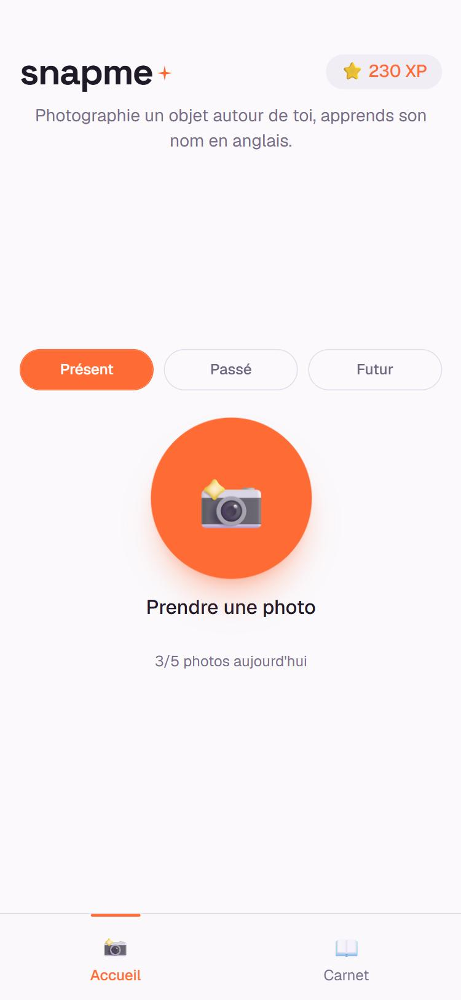
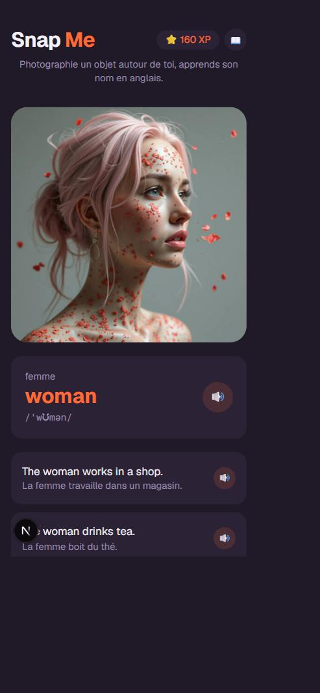
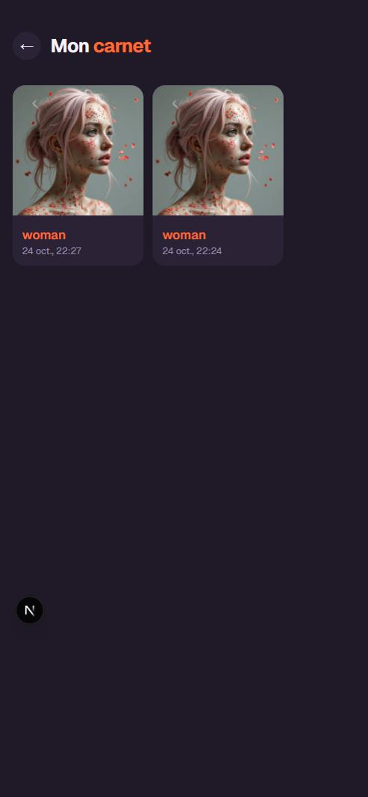
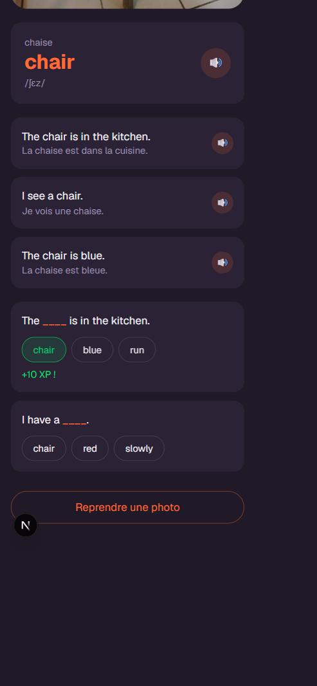

# Snap Me

Apprendre l'anglais à partir des objets qui t'entourent, une photo à la fois.

Snap Me est une application web qui apprend l'anglais aux francophones débutants à partir de photos de leur propre environnement : tu photographies un objet autour de toi, le modèle l'identifie, te donne le mot anglais, le fait prononcer par une voix naturelle, et te propose de construire des phrases avec.

Projet réalisé pour le **Hacktoberfest Hack Day Libreville 2026**, organisé par le Microsoft User Group Gabon, sur le thème *« AI belongs to everyone »*.

## Le problème

Apprendre l'anglais à Libreville coûte cher. Un professeur particulier est hors de portée de la plupart des familles, et les méthodes classiques (manuels, listes de vocabulaire) demandent une discipline que peu de débutants tiennent sur la durée.

## Pourquoi la photo

On retient mieux un mot attaché à un objet de son propre quotidien qu'un mot perdu dans une liste. Photographier la banane sur sa table plutôt que lire *"banana"* dans un manuel crée une association concrète entre le mot et le monde réel de l'utilisateur, et donne une raison de revenir chaque jour.

## Comment ça marche

1. Tu prends ou choisis une photo d'un objet.
2. L'image est redimensionnée et compressée dans le navigateur avant tout envoi.
3. **Gemma 4** identifie l'objet et renvoie un JSON structuré : le mot anglais, sa transcription phonétique, trois phrases d'exemple au temps grammatical de ton niveau, et deux exercices à trous.
4. Tu peux écouter la prononciation, construite par **Kokoro-82M**, un modèle de synthèse vocale qui tourne entièrement dans ton navigateur.
5. Chaque exercice réussi rapporte de l'XP, qui débloque progressivement le passé puis le futur.
6. Le snap est archivé dans un carnet consultable hors ligne.

Un quota de 5 photos par jour est volontaire : il pousse à choisir un objet qui compte plutôt qu'à mitrailler, et crée une habitude quotidienne plutôt qu'un usage compulsif.

## Deux modèles open-weights, aucun modèle propriétaire fermé

C'est l'argument central du projet : toute la chaîne de valeur IA repose sur des modèles ouverts.

- **[Gemma 4](https://ai.google.dev/gemma)** (Google DeepMind) pour la compréhension de l'image et la génération pédagogique, via l'API Gemini.
- **[Kokoro-82M](https://huggingface.co/onnx-community/Kokoro-82M-v1.0-ONNX)** (Apache-2.0) pour la synthèse vocale, exécutée à 100% côté client via [Transformers.js](https://huggingface.co/docs/transformers.js), sans qu'aucune donnée audio ne soit envoyée à un serveur.

Aucun service propriétaire fermé n'intervient dans le parcours d'un snap.

## Le choix de la compression d'image

Chaque photo est redimensionnée et réencodée en JPEG qualité 0.7 via un canvas, avant tout envoi réseau : une version à 512px part vers l'API (moins d'octets à envoyer, moins de tokens image à traiter côté modèle), une version à 768px reste affichée à l'écran et sauvegardée dans le carnet, où la qualité visuelle compte plus que la vitesse. Le réseau à Libreville est lent et les forfaits data se paient : envoyer une photo brute de plusieurs méga-octets à chaque snap est un défaut produit, pas un détail technique. C'est aussi pour ça que la voix tourne en local plutôt que de dépendre d'un aller-retour réseau à chaque écoute.

## Captures d'écran

| Capture → identification | Phrases & exercices | Carnet |
|---|---|---|
|  |  |  |



## Stack technique

- **Next.js**, App Router, TypeScript
- **Tailwind CSS v4**
- **Google Gemini API** pour accéder à Gemma 4 : clé API côté serveur uniquement, jamais exposée au client
- **kokoro-js** pour la synthèse vocale dans le navigateur, avec repli automatique sur `window.speechSynthesis` si Kokoro est indisponible
- **localStorage** pour toute la persistance (XP, niveau, quota, carnet)
- Pas de base de données, pas d'authentification : une contrainte délibérée pour rester livrable dans le temps du hackathon

## Lancer le projet en local

```bash
npm install
```

Crée un fichier `.env.local` à la racine avec ta clé API Gemini :

```
GEMINI_API_KEY=ta_clé_ici
```

Puis :

```bash
npm run dev
```

Ouvre [http://localhost:3000](http://localhost:3000).

## Limites assumées

- Pas de compte, pas de synchronisation entre appareils : la progression vit dans le navigateur utilisé.
- Le carnet est plafonné à 50 snaps pour rester dans les limites raisonnables du `localStorage`.
- Un seul objet est identifié par photo, même si plusieurs sont visibles.
- La latence de l'API Gemma 4 peut dépasser 30 secondes selon la charge, acceptable pour un usage quotidien réfléchi, moins pour un usage impatient.

## Suite envisagée

- Export/import de la progression pour changer d'appareil sans tout perdre.
- Reconnaissance de plusieurs objets par photo.
- Mode révision espacée sur le carnet, au lieu d'une simple liste chronologique.

## Auteur

Louis-Gériel Ngabi (Nelge 3D), développeur web et artiste 3D à Libreville, professeur d'anglais à l'English Language Institute.
